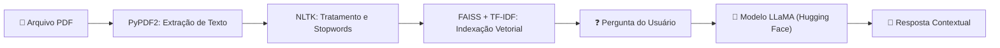

# 📄 RAG PDF Assistant

Assistente inteligente para leitura de documentos PDF e resposta a perguntas em linguagem natural, utilizando técnicas de **RAG (Retrieval-Augmented Generation)**, indexação vetorial com **FAISS** e modelos de linguagem **LLaMA** via Hugging Face Transformers.

O aplicativo possui uma interface desktop amigável construída em **Tkinter**, permitindo carregar qualquer arquivo PDF localmente e realizar perguntas contextuais.

---

## 💡 Como Funciona o Pipeline



1. **Ingestão:** O usuário seleciona o PDF através da interface gráfica.
2. **Pré-processamento:** O texto é limpo, tokenizado e as stopwords em português são filtradas com `NLTK`.
3. **Indexação:** Os vetores semânticos são gerados e indexados via `FAISS` (IndexFlatL2).
4. **Geração:** O modelo LLaMA processa a pergunta junto com o contexto recuperado do documento para produzir uma resposta precisa.

---

## 🛠️ Tecnologias Utilizadas

- **[Python](https://www.python.org/)** (>= 3.10)
- **[Tkinter](https://docs.python.org/3/library/tkinter.html)** - Interface desktop nativa
- **[PyPDF2](https://pypdf2.readthedocs.io/)** - Extração de dados de PDFs
- **[NLTK](https://www.nltk.org/)** - Processamento de Linguagem Natural e stopwords
- **[FAISS (Facebook AI Similarity Search)](https://github.com/facebookresearch/faiss)** - Busca por similaridade vetorial
- **[Hugging Face Transformers](https://huggingface.co/docs/transformers)** & **[PyTorch](https://pytorch.org/)** - Carregamento e inferência de modelos LLM

---

## 📦 Como Instalar e Rodar

1. **Clone o repositório:**
   ```bash
   git clone https://github.com/Renatocslima/rag-pdf-assistant.git
   cd rag-pdf-assistant
   ```

2. **Crie e ative um ambiente virtual:**
   ```bash
   python -m venv .venv
   .venv\Scripts\Activate.ps1
   ```

3. **Instale as dependências:**
   ```bash
   pip install -r requirements.txt
   ```

4. **Inicie a aplicação:**
   ```bash
   python main.py
   ```

> [!NOTE]
> Para usar modelos restritos como LLaMA 3.1 ou LLaMA 2, certifique-se de estar autenticado com sua conta Hugging Face via terminal executando `huggingface-cli login`. Você também pode alterar o modelo padrão para qualquer LLM causal aberto em `model_loader.py`.

---

## 👤 Autor

Desenvolvido por **[Renato Lima](https://github.com/Renatocslima)**.
